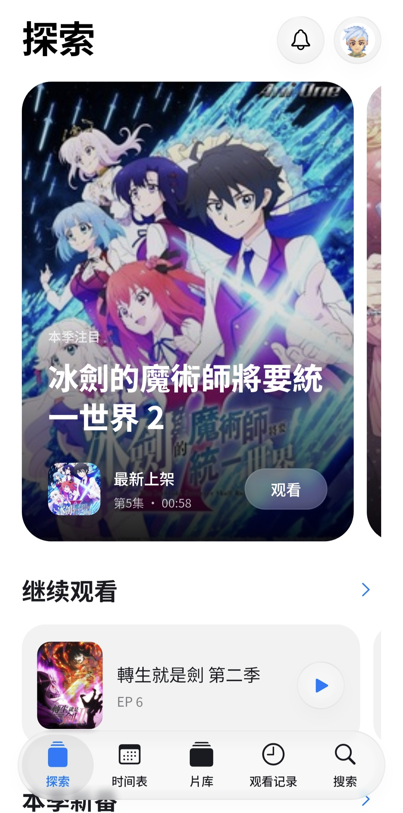
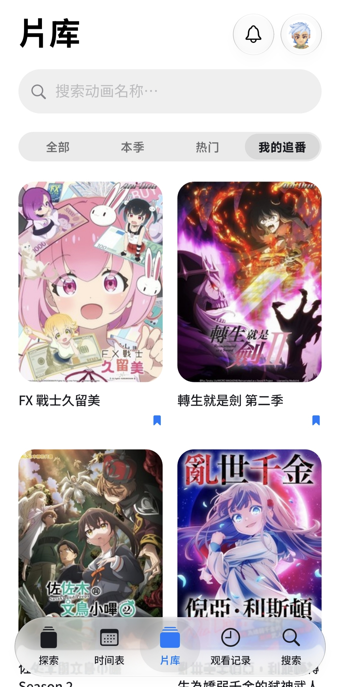
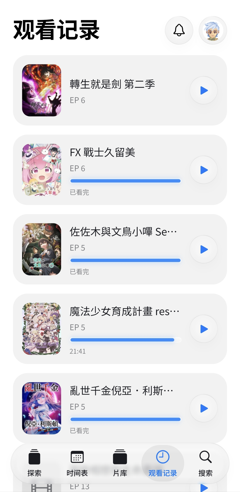
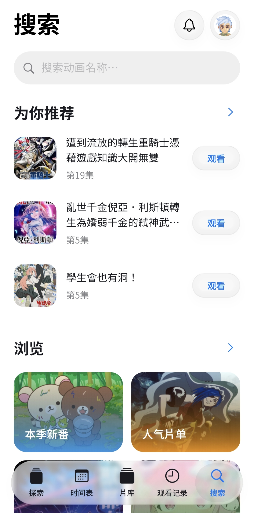
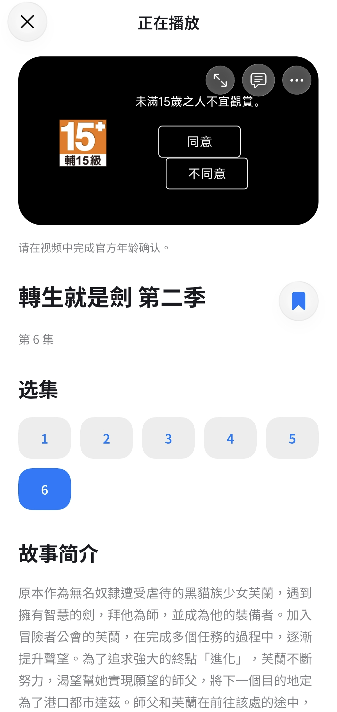

> [!IMPORTANT]
> **重要声明**
>
> 1. 本项目是个人爱好作品。作者是巴哈姆特动画疯的粉丝，希望以 iOS 液态玻璃风格打造属于自己的巴哈姆特动画疯客户端。
> 2. 本项目与巴哈姆特动画疯官方没有任何关系。
> 3. 本项目是完全公益的开源作品，不涉及付费或盈利功能。
> 4. 本项目不涉及任何破解或去广告功能。未登录用户和非会员用户的播放体验与官方播放没有任何差别。

  
  <h1>Baha Plus</h1>
  
一个为巴哈姆特动画疯打造的第三方客户端

  
发现新番，接着追番，让喜欢的故事陪伴每一天。

  

    <a href="#功能">功能</a> ·
    <a href="#下载安装">下载安装</a> ·
    <a href="#开始使用">开始使用</a> ·
    <a href="#常见问题">常见问题</a> ·
    <a href="#反馈与贡献">反馈与贡献</a>
  

> Baha Plus 目前处于开发和体验阶段，功能与使用体验可能随开发变化。

## 功能

### 发现想看的动画

- 在首页浏览本季注目、人气作品和新番时间线。
- 通过每周时间表查看更新，或在片库中浏览作品封面。
- 搜索动画并查看作品介绍、剧集和播放入口，支持简体与繁体中文关键词。
- 目录、搜索和带影片 ID 的详情直接读取官方公开资料，这些页面无需加载隐藏网页；读取失败时显示错误并提供重试。

### 继续你的追番日常

- 登录巴哈姆特账号，查看官方账号资料、追番收藏和观看记录。
- 从观看记录进入对应剧集，继续未看完的内容。
- 在详情页查看选集、切换剧集，并管理追番收藏。

### 按自己喜欢的方式观看

- 支持横屏播放、进度调整、快进与后退、静音、倍速和弹幕开关。
- 播放时长按画面约半秒且不滑动，即可临时以 2 倍速快进；松手后恢复原来的播放速度。
- 在正片播放页读取官方弹幕，并通过液态玻璃面板调整透明度、字号、显示位置和颜色；弹幕发送入口保留官方账号校验。
- 在剧集页查看对应集数的官方留言板，支持建议／时间排序、分页、回复、推嘘和留言输入；留言区使用液态玻璃输入栏。
- 详情页显示官方提供的评分；数据包含评分人数与星级分布时显示完整统计。留言预览按官方建议顺序最多展示十条，滚动到底可打开完整留言板。
- 故事简介超过 200 字时可打开完整简介；留言板位于简介下方，弹幕入口位于视频画面内。
- 在通知中心查看官方账号订阅番剧的更新，未读状态按账号保存在设备上，点击通知可直接进入对应剧集。
- 在官方提供的选项中选择画质；可用画质取决于作品、账号和官方服务。
- 支持简体中文和繁体中文界面，以及浅色、深色和跟随系统的外观。
- 启动后静默检查新版本，仅在发现更新时弹窗显示版本号与更新内容。在账号面板点击版本号或“检查更新”可手动检查，没有新版时提示“无可用更新”；点击弹窗中的下载按钮会打开仓库 Releases 页面。
- 在账号面板的“问题反馈与日志”中开始采集，复现问题后停止，再预览并导出分享日志。未登录用户和正式版也能使用，无需连接电脑。

播放使用动画疯官方的播放环境，广告、会员权益、年龄验证及地区限制均以官方规则为准。部分账号同步和播放功能仍在验证中，详见下方说明。

## 界面预览

以下为实机运行 App 的画面，封面与影片来自动画疯官方服务。

<table>
  <tr>
    <th>探索</th>
    <th>片库</th>
    <th>观看记录</th>
    <th>搜索</th>
    <th>播放页</th>
  </tr>
  <tr>
    <td></td>
    <td></td>
    <td></td>
    <td></td>
    <td></td>
  </tr>
</table>

## 下载安装

请前往 [GitHub Releases](https://github.com/InternetBugs/Baha-Plus/releases) 下载最新版本。

- Android 需要 Android 7.0（API 24）或更高版本。
- Android APK 按架构分别提供：多数手机选择 `arm64-v8a`，32 位 ARM 设备选择 `armeabi-v7a`，64 位 Intel／AMD 设备或模拟器选择 `x86_64`。
- iOS 版本需要自行解决证书签名问题。

想自行构建的用户可以参考 [开发与构建](docs/development.md)。

## 开始使用

1. 打开 Baha Plus，在首页、时间表或片库中寻找感兴趣的作品，也可以直接搜索。
2. 点击作品查看介绍和选集，再选择剧集开始播放。
3. 想查看追番或观看记录时，点击首页右上角的账号入口，进入官方页面登录并按提示完成验证。
4. 在账号面板或底部导航中查看追番与观看记录；语言和外观可在账号面板中调整。

账号登录、年龄确认等验证需要在显示的官方页面中由你自行完成。账号会话保留在设备的 WebView 中；应用不会导出密码或 Cookie，也不会另建本地收藏或观看历史。

## 常见问题

**为什么有的动画无法播放，或者需要观看广告？**

Baha Plus 使用动画疯官方播放环境。影片的地区限制、会员资格、广告和年龄验证仍由官方决定，请根据页面提示操作。

**为什么片库里找不到某部作品？**

目前片库展示已读取的首页目录，还不支持完整历史片库的分页浏览。可以尝试使用搜索查找其他作品。

**追番和观看进度会同步吗？**

应用读取官方账号的追番与观看记录，登录后也会自动更新账号资料和记录。观看记录的读取已在 Android 模拟器验证；追番增删和播放进度写回尚未完成全面验收，请暂时不要依赖这些操作已经成功同步。

**iPhone 如何安装？**

请前往 [GitHub Releases](https://github.com/InternetBugs/Baha-Plus/releases) 下载最新版本，并自行解决证书签名问题。

**遇到问题怎么办？**

点击右上角头像，进入“问题反馈与日志”（繁体界面为“問題回報與日誌”）：

1. 点击“开始采集”，返回应用并重复出现问题的操作。
2. 回到日志页面，点击“停止采集”，再“预览日志”。
3. 点击“导出并分享日志”，通过系统分享将 `.txt` 文件发给开发者，或保存文件后在 [Issues](https://github.com/InternetBugs/Baha-Plus/issues) 中附加。分享不可用时，可“复制日志”后粘贴到反馈中。

请补充设备型号、发生时间、复现步骤和必要的错误截图。日志包含应用／系统版本、播放状态、页面加载错误及错误代码位置；不采集密码、Cookie、留言正文或影片内容，并过滤账号字段和网址。提交前仍请预览日志，并遮盖截图中的个人资料。

采集默认关闭，手动开启后即使重启应用也会继续，直到停止。日志保存在本机，只有主动分享时才交给所选应用；两份轮转记录合计不超过 1 MiB，本机最多保留三份导出文件。可随时“清除本机日志”。采集前的操作和系统级原生崩溃堆栈不在记录范围内；若遇到闪退，可重新启动后导出此前已记录的内容。

## 反馈与贡献

欢迎通过 [Issues](https://github.com/InternetBugs/Baha-Plus/issues) 提出建议或报告问题，也欢迎提交 Pull Request。开发、构建与验证说明见 [开发与构建](docs/development.md) 和 [本地验收记录](docs/verification.md)，界面样式见 [液态玻璃设计语言](docs/liquid-glass.md)。

## 声明与致谢

Baha Plus 是第三方项目，与巴哈姆特及动画疯官方没有从属关系。动画内容及相关权益属于其各自权利人，请遵守官方服务条款及所在地适用规定。

项目基于 [Flutter](https://flutter.dev/) 开发，界面使用 [liquid_glass_widgets](https://pub.dev/packages/liquid_glass_widgets)，中文字体使用 Noto Sans TC 和 Noto Sans SC。感谢所有开源项目的贡献者。

本项目按照 [MIT License](LICENSE) 开源；第三方资源遵循各自的许可协议。
